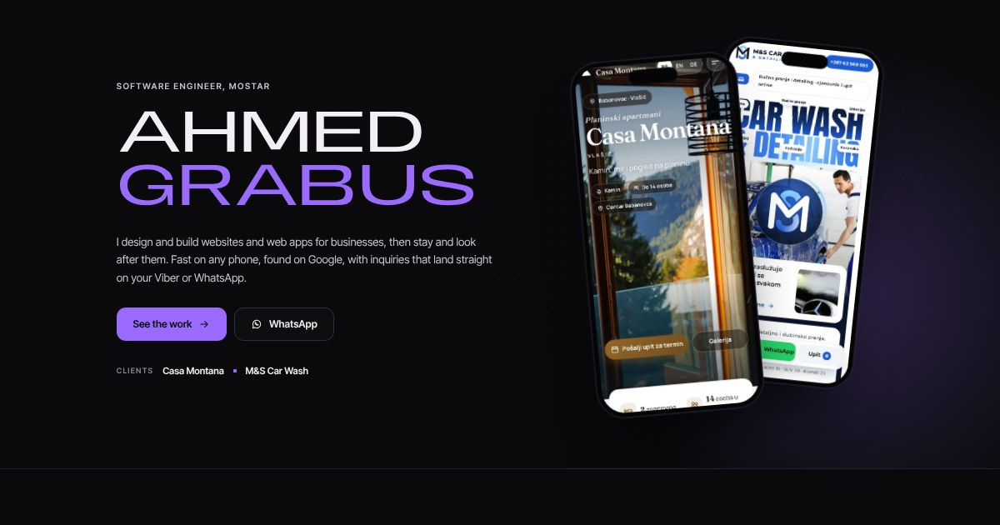

<div align="center">


# Ahmed Grabus

Software engineer from Mostar. I design and build websites and web apps for businesses, then stay and look after them.

[Portfolio](https://graba-portofolio.grabafaceit.workers.dev) &nbsp;&nbsp; [WhatsApp](https://wa.me/387603494625) &nbsp;&nbsp; [Email](mailto:grabafaceit@gmail.com)

<br>



</div>

<br>

## Work

| Project | | |
|---|---|---|
| **Casa Montana** | Mountain apartments on Vlašić. Three languages, real photos and video, inquiries straight to Viber and WhatsApp, Google Business Profile. | [Open](https://casamontanavlasic.com/) |
| **M&S Car Wash** | Car wash and detailing in Travnik. Website with the full price list and inquiries, plus the whole brand for print and Instagram. | [Open](https://mscarwashdetailing.com/) |
| **MyShishapedia** | My own product. A hookah flavor encyclopedia in four languages (EN, BS, DE, RU), about 5,000 pages, growing on Google with daily SEO work. | [Open](https://myshishapedia.com) |
| **SquadJury** | Fantasy Premier League app on Cloudflare Workers, D1 and R2. | [Open](https://squadjury.com) |

More projects are on the site.

## Clients

> Working with Ahmed was really easy. He understood what we wanted right away, explained everything simply and made every change quickly.
>
> **Casa Montana**, owners

> From the first conversation to the finished site, everything went smoothly. Always on time and without any complications.
>
> **M&S Car Wash**, owners

## The site

- Black and purple, headings in Anybody, text in Inter Tight.
- A floating bar on top with the live time in Mostar. On phones it opens downward into a full menu.
- The name rises letter by letter, two phones scroll through real client sites, counters run when they come into view. Everything pauses off screen and stays still when the system asks for reduced motion.
- On phones and tablets a button opens a 3D room built with three.js.
- English and Bosnian. The whole page is written into `index.html` as real HTML, so search engines see everything.

## Tech

Plain HTML, CSS and JavaScript, no framework and no build step. three.js for the room. Hosted on Cloudflare Workers.

## Run locally

```
node serve.mjs
```

Open http://localhost:8080. After changing `js/i18n.js` or `js/classic.js`, run `node tools/staticno.mjs` to write the page into `index.html` and refresh the script hashes in `_headers`.
