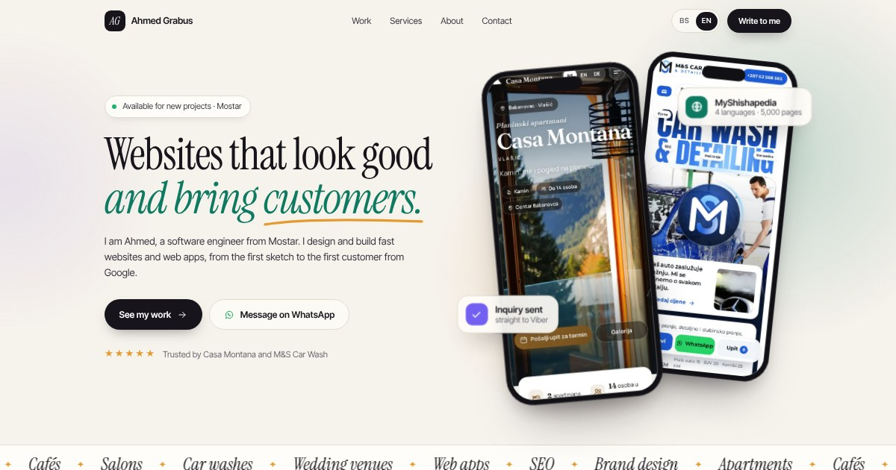

<div align="center">

# Ahmed Grabus

**Software engineer from Mostar, Bosnia and Herzegovina.**
I design and build fast websites and web apps for businesses, from the first sketch to the first customer from Google.

[**Visit the portfolio**](https://graba-portofolio.grabafaceit.workers.dev) &nbsp;·&nbsp; [WhatsApp](https://wa.me/387603494625) &nbsp;·&nbsp; [Email](mailto:grabafaceit@gmail.com)

<br>



</div>

<br>

## Selected work

| Project | What it is | |
|---|---|---|
| **Casa Montana** | Mountain apartments on Vlašić. Three languages, real photos and video, inquiries straight to Viber and WhatsApp, Google Business Profile. | [Live](https://casamontanavlasic.com/) |
| **M&S Car Wash** | Car wash and detailing in Travnik. Website with the full price list and inquiries, plus the whole brand for print and Instagram. | [Live](https://mscarwashdetailing.com/) |
| **MyShishapedia** | My own product: a hookah flavor encyclopedia in four languages (EN, BS, DE, RU), about 5,000 pages, grown on Google with daily SEO work. | [Live](https://myshishapedia.com) |
| **SquadJury** | Fantasy Premier League app on Cloudflare Workers, D1 and R2. | [Live](https://squadjury.com) |

More projects (salon, wedding venue, mountain cabin, shisha lounge, reservations app and others) are on the site.

## What clients say

> *"Working with Ahmed was really easy. He understood what we wanted right away, explained everything simply and made every change quickly."*
> **Owners, Casa Montana**

> *"From the first conversation to the finished site, everything went smoothly. Always on time and without any complications."*
> **Owners, M&S Car Wash**

## About this site

- **Main page:** a light, clean design with a serif headline, two phones that scroll through real client sites, featured case studies, client quotes, services, about and contact. Quiet animations (words rising in, counters, a soft tilt that follows the mouse), all paused off screen and turned off when the system asks for reduced motion.
- **3D room:** on phones and tablets, a button opens a room built with three.js, where every object opens a part of the portfolio.
- **Languages:** English and Bosnian.
- **Fast and indexable:** plain HTML, CSS and JavaScript with no framework and no build step. The full page is written into `index.html` as real HTML, so search engines and readers without JavaScript see everything.

## Tech

`HTML` `CSS` `JavaScript` `three.js` `Cloudflare Workers`

In other projects: `.NET` `C#` `Angular` `React` `Next.js` `Flutter` `Java` `SQL Server` `Docker`

## Run locally

```
node serve.mjs
```

Then open http://localhost:8080. After changing `js/i18n.js` or `js/classic.js`, run `node tools/staticno.mjs` to write the page into `index.html` and refresh the script hashes in `_headers`.

## Contact

**WhatsApp / Viber:** +387 60 349 4625 &nbsp;·&nbsp; **Email:** grabafaceit@gmail.com &nbsp;·&nbsp; **GitHub:** [grabator](https://github.com/grabator)
